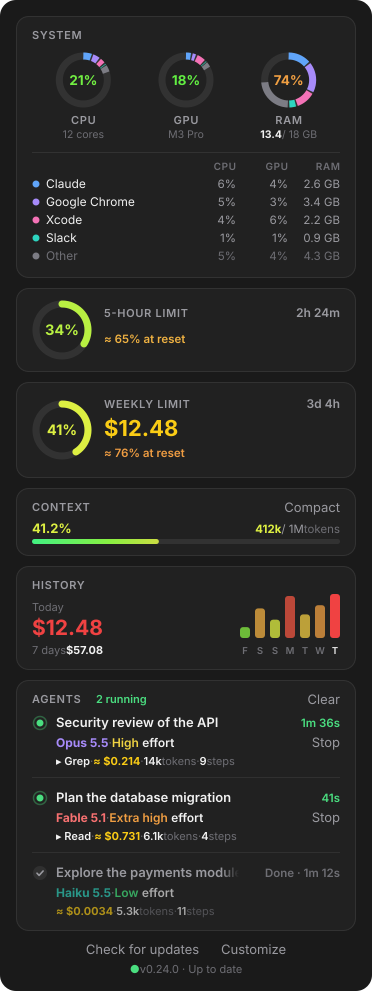

<div align="center">

# Conso

**The usage panel for Claude Code.**
Limits, context, costs and live agents, in a panel right next to your conversation.



</div>

---

## Contents

- [What the panel shows](#what-the-panel-shows)
- [Installation](#installation)
- [Usage](#usage)
- [Updates](#updates)
- [How the numbers are computed](#how-the-numbers-are-computed)
- [Privacy](#privacy)
- [FAQ](#faq)
- [Uninstall](#uninstall)
- [Development](#development)

## What the panel shows

| Card | Content |
| --- | --- |
| **5-hour limit** | Percentage used, a gauge from green to red, time until the reset, and a forecast at your average pace. |
| **Weekly limit** | The same for the week, plus the cost of the current session. |
| **Context** | How full the context window is (tokens used / available) and a **Compact** button to compact it. |
| **History** | Today's cost and the last 7 days, across all your sessions. |
| **Agents** | Every agent, live: model, effort level, duration, current tool, steps, tokens and estimated cost. **Stop** ends an agent cleanly, **Clear** removes the finished ones. |

Color is kept for the numbers that matter. Percentages go from green to red as they approach 100%, and each model family has its own color: Fable in red (the most expensive), Opus in violet, Sonnet in blue, Haiku in teal.

In the terminal, Conso shows a compact bar above the prompt with the same figures.

## Installation

**Requirements:** a version of Claude Code that supports mods. The 5-hour and weekly limits are only available on a Pro or Max plan. Without a plan, the panel shows the session cost instead.

From a terminal, run these two commands:

```bash
claude plugin marketplace add PoPs9444/conso-bar
```

```bash
claude plugin install conso-bar@conso-bar --scope user
```

The first adds this repository as a plugin source, the second installs Conso for all your conversations.

On recent versions of Claude Code, a single command inside a session is enough:

```
/plugin install conso-bar --marketplace PoPs9444/conso-bar
```

Answer `y` to add the source, then pick the **user** scope.

Then restart Claude Code. The **Conso** panel opens on the right at the start of every conversation.

## Usage

- **`/conso`** reopens the panel if you closed it.
- **Compact** (Context card) compacts the conversation, like `/compact`.
- **Stop** (next to a running agent): the agent can no longer start tools and hands back at its next step. A command that is already running finishes first, so nothing is left half done.
- **Clear** (Agents card) removes finished agents to free up space.

## Updates


Conso checks this repository for a newer version when a session starts, then every 6 hours. When there is one, a banner appears at the top of the panel. **Update** runs Claude Code's official commands to download the new version. Restart Claude Code to apply it.

To update by hand:

```bash
claude plugin marketplace update conso-bar
```

```bash
claude plugin update conso-bar@conso-bar
```

## How the numbers are computed

- **Limits** come from Claude Code, which receives them with every model reply, rounded to whole percentages. A new conversation shows the last known reading right away, and every session reads it again each minute.
- **Forecast** uses your average pace since the window started, nights and breaks included ("≈ 65% at reset" or "100% in ≈ 1d 22h"). A burst of activity does not make it run away. It appears after 30 minutes for the 5-hour limit and after 24 hours for the weekly limit.
- **Session cost and history** use the total Claude Code computes at public API prices, the same as `/cost`. On a subscription this is not what you pay: it is what the same usage would cost pay-as-you-go.
- **Agent cost** is an estimate from the agent's tokens and each model's public prices ([`hooks/pricing.ts`](hooks/pricing.ts)).

## Privacy

Conso sends nothing anywhere. Everything is computed and stored on your machine. Its only network request reads the version number published in this repository, to offer updates.

## FAQ

**Why do the limits have no decimals?**
Claude Code reports them rounded to whole percentages. Showing a decimal would mean making it up.

**The percentage does not move when I am not typing.**
Limits are only known when the model replies. Without a message, no session receives a new reading.

**The panel does not appear.**
Check that the plugin is enabled with `claude plugin list`, restart Claude Code, then type `/conso`.

## Uninstall

```bash
claude plugin uninstall conso-bar@conso-bar
```

## Development

```
.claude-plugin/   plugin and marketplace manifests
hooks/            the code: register.tsx (events and panel), dashboard.ts and agents.ts (drawings), pricing.ts (prices)
types/            the contract for the values the mod keeps
tests/            the tests
docs/             the images in this README, drawn with the mod's own code
```

Validate and test:

```bash
claude plugin validate .
```

```bash
claude plugin test .
```

To release a version, bump `version` in `.claude-plugin/plugin.json` **and** the `VERSION` constant in `hooks/register.tsx`, then push to `main`. The update banner will show up for everyone.
